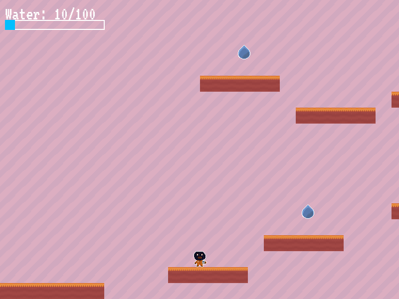
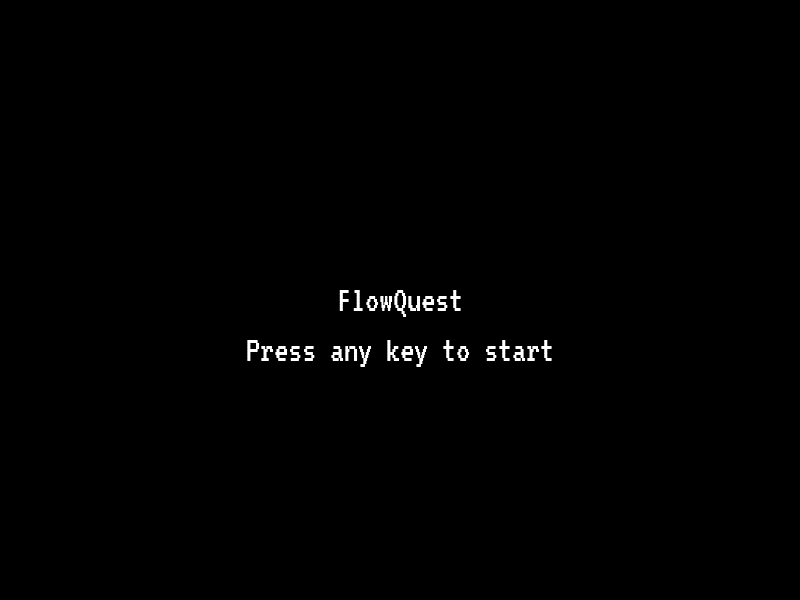
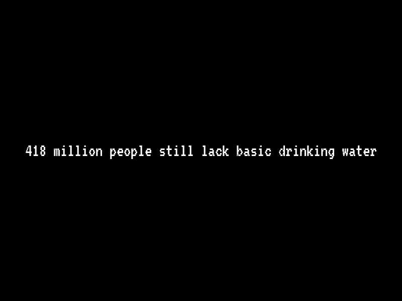

# FlowQuest

> A short pixel-art platformer about SDG 6, clean water and sanitation. You play a hero collecting water for your village.



**Part of [phamduylong.com](https://phamduylong.com)** · `type: school` · `status: finished` · `made: November 2024, Design Technology, grade 10 (IB DP foundation year)`

---

## Why I built it

The Design Technology brief was to make a game that educates people and spreads awareness of one of the UN Sustainable Development Goals. I chose SDG 6, clean water and sanitation. The game opens with facts about water and sanitation access in Africa, then turns collecting water into the goal of the level.

## Before → after

| Before | After |
| --- | --- |
| A design brief: raise awareness of SDG 6 through a game | A playable platformer that opens with the facts and makes collecting water the way you win |

## What it does

- **Title and intro screens** set up the story: a village without water, and you as the one who collects it.
- **One side-scrolling level** built from 32 × 32 tiles, with platforms to jump between and 10 water drops to collect.
- **A water meter** in the corner. Each drop adds 10, and the meter is full at 100.
- **Falling off the bottom** shows "You Died!" and sends you back to the start. Drops you've already collected stay collected.
- **Collecting every drop** shows the win screen, *"Your Village is saved from thirst!"*, and the game closes.

## How to play

| Key | Action |
| --- | --- |
| ← → | Move |
| Space | Jump |
| Any key | Skip through the intro screens |

## How it works

The game is written in Python with Pygame.

- **The level is plain text.** Each row is a string where `.` is empty space, `#` is a terrain tile and `D` is a water drop. `load_level()` turns that grid into sprites, so the level can be redesigned by retyping characters, with no level editor:

  ```
  ..................D...........
  ................#####.........
  ##########....................
  ```

- **The player** has simple physics: a constant gravity pull every frame, a fixed jump speed, and collision checks done separately for the horizontal and vertical moves, so landing on and bumping into platforms both work.
- **The camera** follows the player and is clamped to the level's edges. The background is a single 32 × 32 grid tile repeated across the screen with the camera's offset, so it works at any screen size.
- **Collecting** uses Pygame's sprite collision. A drop is removed when the player touches it, and the level ends once none are left.

## Built with

`Python` · `Pygame` · pixel art drawn for this project · [VT323](https://fonts.google.com/specimen/VT323) font

## Run it

```bash
git clone https://github.com/pdlong-09/FlowQuest.git
cd FlowQuest
pip install -r requirements.txt
python code_1.py
```

Run it from inside the `FlowQuest` folder, because the game loads its images and font from `assets/` by relative path.

## Design process

This was a full Design Technology project, not only the code:

1. **Research.** I surveyed students aged 15 and over about which visual styles they found engaging, how much they knew about clean water and sanitation, and how long they liked to play. Secondary research covered what games teens play, how sustainability games teach, and which languages and sprite tools suit a small 2D game.
2. **Existing products.** I analysed three games with ACCESS FM:
   - *Jump King*, for its minimal retro pixel style and compact levels.
   - *Celeste*, for pixel art that still tells a story.
   - *Aquation* (Smithsonian Science Education Center), a freshwater-access game that keeps the focus on learning.
3. **Making it** over about four weeks in November 2024:
   - The sprites came first: the character, the water drop, the terrain and the grid tile.
   - Then I switched to Pygame because it was easier to work with.
   - Then I built the title screens, the terrain, the player physics, the camera, the water counter, the text-based level and the win screen, roughly in that order.

## What I learned

[Long: 2–3 sentences in your own words. For example, the text-grid level idea, the player physics, or what you'd do differently now.]

## Limitations

- **There's only one level**, and the game closes itself a few seconds after you win. There's no menu, pause or restart.
- **The intro statistics aren't cited** in the game.
- **There's no sound.** It's keyboard only, and it has to be run from its own folder.
- **The player never actually delivers the water.** Collecting the drops is the whole loop.

## Credits

- Font: [VT323](https://fonts.google.com/specimen/VT323) by The VT323 Project Authors, SIL Open Font License.
- Some setup code and ideas came from a Pygame platformer tutorial: [Long: add the tutorial link].
- Existing products analysed: *Jump King*, *Celeste*, *Aquation*.

<p>
  
  
  
</p>

---

<sub>Phạm Duy Long · Hà Nội · [phamduylong.com](https://phamduylong.com)</sub>
